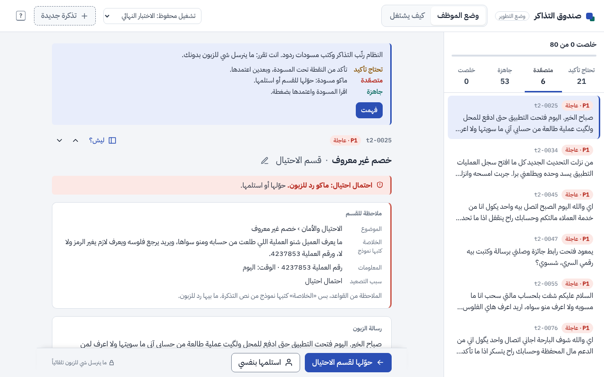
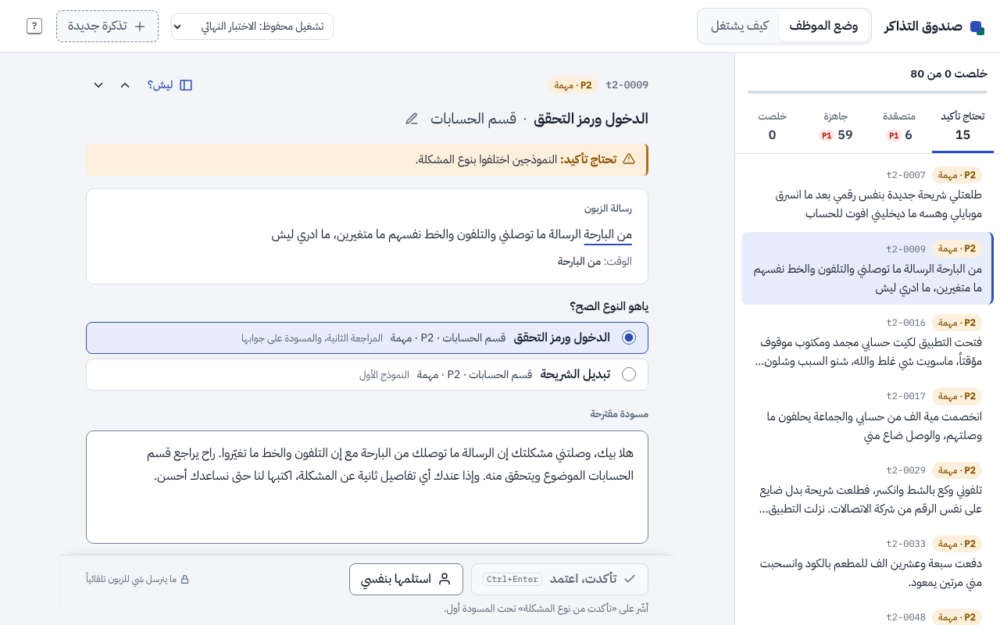
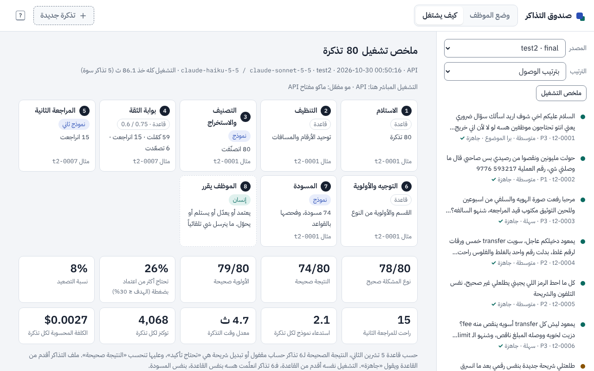

# Support Pipeline Automation

**Agentic AI Challenge Iraq · Topic 06** · Salih Safaa Mohammed

A batch pipeline that sorts customer support tickets written in **Iraqi Arabic dialect** (Baghdadi, southern, Mosuli), pulls out the details, routes each ticket to the right team with a priority, and pre-drafts a reply in Iraqi Arabic. **A person approves, edits or takes over every ticket. Nothing is sent automatically.**

## Results (final test, 30 Oct)

80 fresh tickets (`data/test2`), run **once** with the final configuration on the API. The author, a native speaker, checked 30 of their labels **before** the run (30/30 right).

| | test2 (80) |
|---|---|
| Ticket type correct | **78/80 (97.5%)** (77/80 as first scored; the author then corrected one label they hadn't checked) |
| Priority correct | 79/80 |
| Transaction reference extracted | 21/21 |
| Fraud tickets escalated, none drafted | **6/6** |
| Needs more than a quick approve (flagged or escalated) | **19%** (target ≤ 30%) |
| Drafts that promise an outcome or ask for a code | 1/74 · 0/74 |
| Cost / time per ticket | **$0.0027** · about 5 s |

Across all 389 measured tickets (dev, mvp_test, heldout): type 385/389 (99.0%), every dialect and writing style at 96–100%, all 28 fraud tickets escalated. Fourteen adversarial tickets (prompt injection, a fake verdict planted in the ticket, requests for another customer's data or for the bot's instructions, Kurdish, empty, very long) were all handled. Details: [`docs/experiments/AUDIT-2026-10-29.md`](docs/experiments/AUDIT-2026-10-29.md) and [`docs/experiments/LOG.md`](docs/experiments/LOG.md).

## The user

A Level-1 support agent handling 100–150 tickets a day, most of them repetitive: transfers that didn't arrive, money sent to the wrong person, login and code problems, agent disputes. The pipeline does the first pass; the agent decides.

## How it works

```
ticket → clean → classify + extract → confidence gate → re-check if unsure → route + priority → draft → person
         rules     Haiku 5.5              rules             Sonnet 5.5             rules         Sonnet 5.5
                                            │
                                            └─ fraud, or still unsure → escalated, with a short note for the team
```

A fixed workflow, not a free-roaming agent: predictable and testable. Models are used only where judgment is needed; routing, priority and the safety checks are plain rules.

- **Confidence gate.** The classifier's confidence is lowered when a rule disagrees (a required field is missing, or a "reference" it found isn't in the text). Below 0.60: escalated. 0.60–0.75, or a high-risk type: a second model classifies the ticket blind. If the two disagree, the ticket is drafted from the second model's answer and flagged; if the second answer is fraud or fails the gate itself, it is escalated. Tickets classified as fraud or security are always escalated.
- **Priority** comes from the problem type, raised one level for a large amount (≥ 1,000,000 IQD or ≥ $750). No word in the ticket changes it.
- **Three outcomes:** ready to approve; flagged (a person should check one thing, named in the note); escalated (no customer draft; the team gets a note with the topic, the facts found, what's missing, why it was escalated, and a one-line summary of what happened).
- **Grounded drafts.** The drafter is told only the ticket, the extracted facts and [`config/policy.yaml`](config/policy.yaml), which is empty on purpose: a deploying team adds its own hours and response times there. Rule checks flag a draft that promises an outcome, gives a time the policy file doesn't, asks for a code or PIN, contains a number not in the ticket, or has stray Latin letters. They have known misses ([`FAILURE_MODES.md`](FAILURE_MODES.md), mode 6).
- **Taxonomy:** 8 categories, 23 types, 9 teams ([`config/taxonomy.yaml`](config/taxonomy.yaml)).

## How it was built and measured

- **Every change was tested with and without it** on the same tickets, with repeat runs to measure noise, before being adopted. Several that looked like improvements were noise or broke something else and were dropped; the log of every test is [`docs/experiments/LOG.md`](docs/experiments/LOG.md).
- **Numbers come from the API.** Development runs used Claude Code on the author's plan (`LLM_BACKEND=cli`, free). Every pipeline run behind a reported number, and the threshold calibration, used the API (`LLM_BACKEND=api`). The draft judge's grades come from cli.
- **Data:** 400 synthetic tickets for development (dev 233, mvp_test 78, heldout 78), then 160 fresh ones for the final test (test2 80, and heldout2 80, sealed: to be run once on the final version). Written by Claude Opus from a seeded plan that crosses type × dialect × writing style × edge case, with code checks for dialect drift, invented numbers and near-duplicates.
- **Human checks:** the author reviewed 34 dev labels (2 corrected), 13 drafts and 2 team notes, and 30 test2 labels before the final run. The author's rules as a native speaker are part of the code and the data (for example «ورقة» is a 100-dollar note, and no urgency word raises priority).

## Known limits

- The tickets and most labels are model-written; a person checked 64 of them. There are no real customer messages in the evaluation.
- The ticket writer, the pipeline and the draft grader are models from the same family.
- The drafter sometimes doesn't ask for a shop or agent's name when the customer only says "the restaurant"; the fix tried made drafts worse.
- Masking covers numbers and codes, not names: saved runs hide every phone, card, account and transaction number of 7+ digits (shorter references stay visible) and any code written after a code word. The response cache, a development tool, keeps replies in full and must stay off for real tickets.
- No support agent has used the inbox yet. Draft quality as agents see it, time saved and how carefully agents review are not measured.

## Security, failure modes and disclosure

- [`SECURITY.md`](SECURITY.md): for a regulated financial institution's security team. What leaves the machine, the controls in the code, what the institution would still have to do, and checks that need no key. It claims compliance with no framework.
- [`FAILURE_MODES.md`](FAILURE_MODES.md): eleven failure modes, each with what goes wrong, how often, how it was found, what was done and what is left.
- [`DISCLOSURE.md`](DISCLOSURE.md): who or what made each part, and what the numbers can and cannot support.

## Run it

```bash
pip install -r requirements-dev.txt             # adds pytest to requirements.txt
pytest                                          # 648 tests, no model calls
python app/server.py                            # viewer: http://localhost:8000; saved runs replay with no key

export SUPPORT_PIPELINE_API_KEY=...             # or ANTHROPIC_API_KEY; live runs need a key
python app/server.py                            # the same viewer, able to run new tickets (API, spending cap)
LLM_BACKEND=api python scripts/run_batch.py data/test2/tickets.jsonl
```

The viewer runs new tickets on the API backend unless `LLM_BACKEND` says otherwise. With no key, live runs are off and the page says so. The scripts default to `LLM_BACKEND=cli` (headless Claude Code on this computer's login), which is for development only, so a batch run on the API needs `LLM_BACKEND=api`. `node tests/ui/smoke.cjs` checks the viewer in a browser with no key and no model call ([`tests/ui/README.md`](tests/ui/README.md)).

**See the final test without a key:** start the viewer. It opens on the final run («الاختبار النهائي (80 تذكرة)» in the agent's picker; "test2 · final" in «كيف يشتغل»). It replays the measured run ([`docs/runs/test2/final.json`](docs/runs/test2/final.json), committed as it was run on 30 Oct) and scores it against the current labels: type 78/80, priority 79/80.

**Saved runs are masked:** `run_batch.py` hides phone, card, account and transaction numbers (7+ digits, also when split by `-`, `.` or spaces, keeping the first and last two) and codes written after a code word (`OTP 482913` → `OTP ******`) in the file it saves. `--no-mask` keeps them, for synthetic test sets scored against their gold labels; the experiment script uses it. Names are not masked.

**Safety switches:** the viewer answers only on localhost, needs the token its page is served with, and refuses tickets over 4,000 characters. `PIPELINE_MODE=off` sends every ticket to a person with no model call (`classify_only` writes no drafts). `REAL_DATA=1` refuses the development-only paths (the free backend, the response cache, `--no-mask`). Details: the 1 Nov security and reliability entry in [`docs/experiments/LOG.md`](docs/experiments/LOG.md).

**The viewer** (standard library only, in Arabic, right to left) has two modes:

- **«وضع الموظف», the agent's inbox,** opens first. A queue in four tabs (تحتاج تأكيد, متصعّدة, جاهزة, خلصت), most urgent first. One ticket at a time: the customer's text with the extracted facts underlined, the draft in an editable box with its checks (they run again as the agent edits), and a decision bar: approve (Ctrl+Enter), edit, take over, or forward an escalation to its team. Friction follows risk: a flagged ticket needs a tick on the one thing to check, a draft the checks flag for asking for a code can't be approved (the page blocks it, and the server refuses it; the checks have known misses, [failure mode 6](FAILURE_MODES.md#6-draft-checks-miss-a-phrasing)), and an escalation has no draft, only the note for the team. Nothing is sent: each decision goes to a decision log (no reply text) and can be undone. A card on the first visit explains the tabs; `?` lists the keys.
- **«كيف يشتغل», how it works,** holds the process: the stages (rule, model or person) with counts and an example ticket each, the confidence gate and the blind re-check, the results against the gold labels, calibration, cost and time, the decisions logged on the run, and any ticket stage by stage with exactly what each model was sent and returned.

With a key you can also paste a new ticket («تذكرة جديدة») and watch it go through live; without one, the page says live runs are off.







More in [`docs/demo/`](docs/demo/). The session summary there (`inbox-done.png`) comes from the smoke test deciding all 80 tickets by script, under 3 s each, so its times are not a person's; the page says so.

| Model role | Model | Used for |
|---|---|---|
| classifier | Claude Haiku 5.5 | classify and extract; the fee and the team-note summary |
| rechecker, drafter | Claude Sonnet 5.5 | the second opinion; the draft reply |
| generator, evaluator | Claude Opus 5.5 | development only: writing tickets, grading drafts |

Any model is one line in [`config/models.yaml`](config/models.yaml). Each API run is priced from its token counts and stops at a spending cap (`budget_usd`, default $5).

## Repo layout

```
src/pipeline/     clean, classify, gate, route, draft, draft_check, handoff, requirements, run, llm
config/           taxonomy, thresholds (and input limits), models (and prices), policy (empty on purpose)
app/              the viewer: server.py; static/ the page, its scripts, styles and bundled fonts
scripts/          run_batch, experiment (with/without tests, judge), calibrate, review_sheet, generate_tickets
data/             dev, mvp_test, heldout, test2, heldout2 (sealed); probes/ older test sets; review/ the author's checks
docs/             experiments/ (LOG.md, AUDIT, per-set pages), runs/ (the final test, replayable), demo/ screenshots, design brief
tests/            pytest suites, no model calls; ui/ the browser smoke test
CONTEXT.md        goals, rules, decisions and status, for anyone picking the project up
SECURITY.md       security, for a deploying institution
FAILURE_MODES.md  what goes wrong, how often, and what is left
DISCLOSURE.md     who or what made each part
```

## Disclosure

<!-- the author to confirm wording: the second bullet repeats DISCLOSURE.md section 3 -->

- All data is synthetic. No real customer data is used anywhere.
- An AI coding assistant, Claude Code, did most of the building. The author states that it wrote most of the code, tests and documents, under the author's direction. The author set the rules, checked labels and drafts as a native speaker, and made every adopt-or-delete decision.
- One model family (Claude) writes the tickets, runs the pipeline and grades the drafts. No outside review of the code or the controls is recorded. The full record: [`DISCLOSURE.md`](DISCLOSURE.md).
