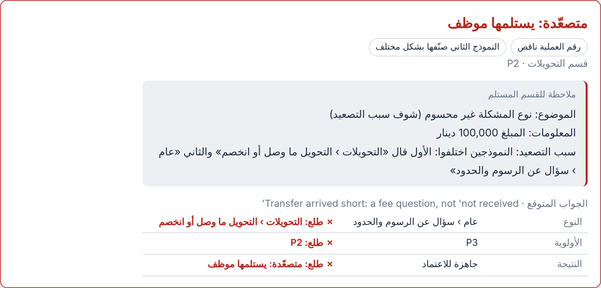

# F17 `handoff_note`: a note for the team that receives an escalated ticket

**Why.** Escalated tickets (all fraud included) get no draft, so the receiving team saw only a flag label such as «احتمال احتيال» and had to re-read everything. Salih asked for a small, meaningful note built from the extracted information.

**How.** `src/pipeline/handoff.py` builds it from fields the pipeline already has. There is **no model call**, so it costs nothing, can't invent anything and can't shift classification (the lesson from F6, F13 and F14). It appears as `handoff_ar` on escalated results only, and the viewer shows it under the outcome. It is off by default (`PIPELINE_FIXES=handoff_note`).

| Line | Content |
|---|---|
| الموضوع | Category › subcategory, or «نوع المشكلة غير محسوم» when the models disagreed or the category was invalid |
| أثر على الحساب / طلب ثاني | For fraud, an account-access secondary is shown as its effect (the customer is locked out), even when F14b cleared the label. Otherwise a separate second request |
| المعلومات | Amount (IQD or USD), disputed fee, transaction number, recipient number, time, as extracted |
| ناقص | Required or checkable fields the ticket doesn't give (not shown when the type is in doubt, since it depends on the type) |
| سبب التصعيد | Possible fraud; both models' answers when they disagreed; invalid category; model error; or low confidence with its value |

**Examples** (built from the saved 19 Oct `mixed_30` classifications, no new model calls):

```
m21  الموضوع: الاحتيال والأمان › خصم غير معروف
     المعلومات: المبلغ 90,000 دينار
     سبب التصعيد: احتمال احتيال

m23  الموضوع: نوع المشكلة غير محسوم (شوف سبب التصعيد)
     المعلومات: المبلغ 100,000 دينار
     سبب التصعيد: النموذجين اختلفوا: الأول قال «التحويلات › التحويل ما وصل أو انخصم» والثاني «عام › سؤال عن الرسوم والحدود»

m28  الموضوع: عام › غير واضح
     سبب التصعيد: الثقة واطية (0.50): نوع المشكلة مو واضح
```



**Testing.** Seven unit tests: off by default, fraud note, lock-out kept with F14b, disagreement, invalid category, low confidence and model error, nothing on non-escalated tickets. It changes no model input, so a with/without experiment run would differ only in this field. Usefulness to the team should be judged by a person (Salih) on real escalations.
